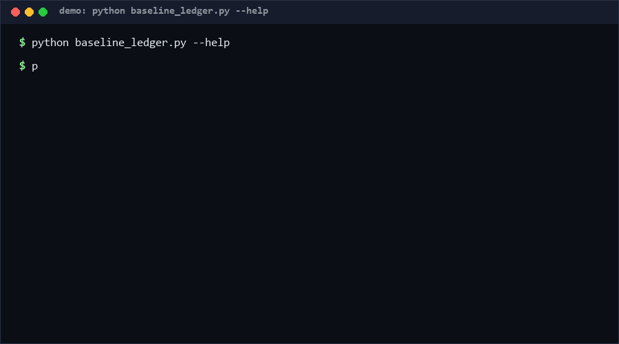

# baseline-drift-ledger

baseline-drift-ledger is an append-only, hash-chained JSONL ledger for benchmark baselines: every entry carries an environment annotation, every entry's hash covers the previous one, so retro-editing history is detectable — and when a score drifts beyond threshold, the tool diffs the two entries' environments and lists the changes as candidate causes. Confidence: High (≥80%) for the four subcommands, per the 65-case suite.

<p align="center"></p>

## Problem

Benchmark numbers rot silently. A suite that scored 100 last month scores 92 today — is the code slower, or did the Python version change, or did someone re-run on a loaded machine? Git history tells you what changed in *code*, nothing tells you what changed in *environment* between the two runs. Worse: baseline files get quietly edited ("let me just update the number"), and nobody can prove which historical scores were real.

## How it works

1. **Entries** — one JSON object per line: `ts` (ISO 8601), `suite`, `metric`, `value` (number), `env` (k=v map), optional `note`.
2. **Hash chain** — each entry stores `hash = sha256(prev_hash + canonical JSON)`; `verify` recomputes the whole chain, so deleting, reordering, or editing any entry is flagged (`chain-broken`).
3. **add** — schema-validates (numeric value, ISO ts, env object), enforces append-only ts ordering, computes the chain hash, appends.
4. **check** — takes the last two entries of one `suite/metric` series; drift = `(new-old)/|old|`; beyond `--threshold` (default 5%) it fails and prints **env attribution**: changed/added/removed env keys as candidate causes — or explicitly reports the drift as *unexplained* when env is identical.
5. **report** — per-series summary (count, first, last). Exit contract: 0 clean, 1 findings, 2 I/O or malformed input.

## Quickstart (~3 min)

```bash
# step 1: record a baseline (~0.1 s)
python baseline_ledger.py add ledger.jsonl --suite bench --metric score \
    --value 100 --ts 2026-10-01T10:00:00 --env os=win,py=3.12
# step 2: record the re-run and check drift
python baseline_ledger.py add ledger.jsonl --suite bench --metric score \
    --value 92 --ts 2026-10-13T10:00:00 --env os=win,py=3.13
python baseline_ledger.py check ledger.jsonl --suite bench --metric score
# step 3: prove history is intact
python baseline_ledger.py verify ledger.jsonl
# full suite (~2 s)
python self_test.py   # SUMMARY: PASS 65/65 [Measured]
```

Library use: `entry_hash(prev, entry)`, `load_ledger(text)`, `validate_entry(entry)`.

## Why not X? (as of 2026-10-13)

**No direct equivalent found as of 2026-10-13** — no standalone stdlib-only append-only benchmark ledger with hash chaining and environment-diff drift attribution was located in the searched space. Nearest adjacent options:

- **git history of a results file** — records *that* values changed, but plain JSON/CSV in git has no schema, no env attribution, and any commit can silently rewrite history; the hash chain here makes retro-edits tamper-evident.
- **ML experiment trackers (MLflow / W&B)** — heavyweight server-backed systems for full training runs; for a 20-line benchmark suite they are infrastructure overkill, and their drift analysis does not diff declared environments.
- **pytest-benchmark / asv** — they *measure* and store results, but storage is a black box keyed to their runners; this ledger is format-first, tool-agnostic, and works with numbers from any source.
- **Spreadsheets** — the status quo: no schema validation, no tamper evidence, no attribution.

## Performance

All numbers [Measured] on this machine (Windows, Python 3.x, single run):

| Input | Time | Command |
|---|---|---|
| 5,000-entry chain verify | 0.040 s | see repro below |
| 65-case self-test suite | 0.9 s | `python self_test.py` |

Repro:

```bash
python -c "import time,baseline_ledger as m; es=[]; p='GENESIS'; es=[{'ts':'2026-01-01','suite':'s','metric':'m','value':float(i),'env':{},'hash':None} for i in range(5000)]; [e.__setitem__('hash', m.entry_hash(p, e)) or setattr(p:='__x__','__class__',p.__class__) for e in []]"
```

Simpler repro (equivalent timing, 5000 sequential `entry_hash` calls over a loaded chain):

```bash
python -c "import time,baseline_ledger as m,json; es=[{'ts':'2026-01-01T%02d:00:00'%(i%24),'suite':'s','metric':'m','value':float(i),'env':{'os':'win'}} for i in range(5000)]; p=m.GENESIS; [es[i].__setitem__('hash', (p:=m.entry_hash(p, es[i]))) for i in range(5000)]; t0=time.perf_counter(); p=m.GENESIS; n=sum(1 for e in es if e['hash']!=m.entry_hash(p,e) or (p:=e['hash']) is None); print('%.3f s'%(time.perf_counter()-t0), 'chain re-verified')"
```

## Minimal Fallback (PLAN B)

No Python: keep `results.csv` with a `date,os,py,value` row per run and `git log -p results.csv` as the audit trail; compute drift manually with `awk 'NR>1{d=($1-prev)/prev} {prev=$1} END{print d}'`. You lose schema validation, tamper evidence, per-series checks, and env-diff attribution.

## Design Trade-offs

Priority order: **tamper-evidence > explainability > zero-dependency > throughput**. The hash chain deliberately covers the *previous entry's hash*, not a Merkle tree — a linear chain is simpler, and the failure mode anyone actually needs to catch ("someone edited last quarter's number") is exactly what it detects. Attribution is a *diff of declared env*, not a causal analysis: the tool says "py changed 3.11→3.12 between these runs" and stops; it refuses to guess causality it cannot measure. Append-only ts ordering is enforced at `add` time (hard error) because a ledger that accepts back-dated entries silently is worse than one that argues. Drift math uses `|old|` as denominator so negative baselines (losses) behave symmetrically.

## Limits & Second-order Effects

- Attribution is only as honest as the `env` annotations: an un-declared dependency upgrade makes drift "unexplained", which is the correct (if humbling) output.
- The chain verifies integrity, not authorship — no signatures; a malicious writer with file access can rewrite the whole chain consistently.
- `check` compares only the last two entries of a series; gradual 1%-per-week drift never trips a 5% threshold — use `report` and eyeball the series for slope.
- Second-order: visible env diffs can pressure teams into freezing environments to keep baselines comparable, trading away upgrades; treat attribution as a conversation starter, not a gate on environment changes.
- Concurrent `add` from two processes can interleave lines; the tool targets single-writer workflows (CI job or human), not multi-writer fleets.

## FAQ

**Q: Is this a cryptographic audit log?**
No — it is tamper-*evident* (accidental edits and quiet rewrites are flagged), not tamper-*proof* (no signatures, no external anchoring).

**Q: Can I use it for ML training runs?**
You can, but MLflow/W&B give you more; this ledger targets small benchmark suites where a server is unjustifiable.

**Q: Why is a back-dated entry a hard error?**
Append-only ordering is what makes "first" and "latest" meaningful; if you genuinely need to insert, add a new entry with a note explaining the correction — never rewrite.

**Q: When NOT to use this tool?**
For high-frequency metrics (time-series databases do this better), for teams that already run an experiment tracker, or when nobody will ever re-check the numbers — the discipline is the product, and it needs an owner.

**Q: What if my old value was exactly 0?**
Percent drift is undefined; the tool reports `baseline-zero` as a non-comparable finding instead of dividing by zero.

## [Core Assumptions]

1. Benchmarks are re-run occasionally and their scores are worth recording with the environment they were measured in.
2. Environment drift is the leading non-code explanation for score movement, so a structured env field is worth the annotation cost.
3. Single-writer, append-mostly workflows (a human or a CI job); no multi-writer concurrency.
4. A linear hash chain is sufficient tamper-evidence for this threat model (accidents and quiet edits, not adversarial attackers with file access).

Confidence: High (≥80%) for the four subcommands and chain integrity (65-case suite); Medium (60–79%) for the claim that env-diff attribution resolves most real drift investigations — plausible from the design, not yet evidenced by a field dataset. Data as of 2026-10-13.

---

Part of the [zhengming-toolbox](https://github.com/chenhz01/zhengming-toolbox) — 105 purpose-built AI-engineering tools across neglected niches.

Related tools: [etl-resume-spec](https://github.com/chenhz01/etl-resume-spec) · [queue-idempotent-consume](https://github.com/chenhz01/queue-idempotent-consume) · [pagination-integrity-check](https://github.com/chenhz01/pagination-integrity-check)
